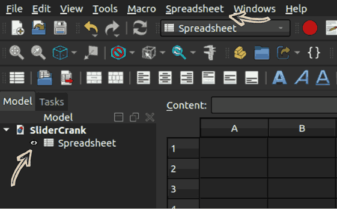

import ParametricMechanicalCadFreecadComments from '../../../../components/parametric-mechanical-cad-freecad/ParametricMechanicalCadFreecadComments.astro';
import TawkWidget from '../../../../components/TawkWidget.astro';
import UniversalContentContributors from '../../../../components/UniversalContentContributors.astro';
import InArticleAd from '../../../../components/InArticleAd.astro';
import Copyright from '../../../../components/Copyright.astro';
import BionicText from '../../../../components/BionicText.astro';
import TailwindWrapper from '../../../../components/TailwindWrapper.jsx';
import { Tabs, TabItem } from '@astrojs/starlight/components';
import { Card, CardGrid, Badge, Steps, LinkButton, FileTree } from '@astrojs/starlight/components';

<UniversalContentContributors 
  contributors={frontmatter.contributors}
/>


import YouTube from '../../../../components/YouTube.jsx';

A pump piston that stops short of the end of its cylinder delivers less water on every turn, and a connecting rod that is too short pushes the piston sideways until the cylinder wall wears out. Two lengths decide both faults: the crank radius and the rod length. If you draw the parts with typed numbers, a change to either length means drawing four parts again. In this lesson you model a slider crank in FreeCAD so that two values in a table drive every part. On the way you learn the FreeCAD basics: sketches, constraints, solid parts, an assembly and a drawing. #FreeCAD #SliderCrank #ReciprocatingMotion #KinematicDesign

:::tip[Simulate before you build]
Before designing the 3D model, try your link lengths in the [Crank-Slider Mechanism Simulator](/product-development/crank-slider-mechanism-simulator/) to see how the crank-to-rod ratio and offset change the stroke, velocity, and acceleration, and to preview the quick-return behavior. For structured kinematic experiments with Python analysis, see the [Mechanism Design and Simulation](/education/mechanism-design-simulation/) course.
:::

## Learning Objectives

By the end of this lesson, you will be able to:

1. Navigate the FreeCAD interface and understand workbenches
2. Create fully constrained 2D sketches with geometric and dimensional constraints
3. Build parametric 3D parts controlled by spreadsheet parameters
4. Assemble multi-part mechanisms with motion constraints
5. Generate professional technical drawings for documentation

## Engineering Context: Why This Mechanism Matters

<InArticleAd />


A slider crank turns rotation into straight motion that goes back and forth, or the reverse. Engine pistons, compressors, hand pumps and sewing machine needles use it.

<YouTube videoId="ulr2Bykphto" title="Slider Crank Mechanism Design in FreeCAD" />

### The Engineering Problem

A slider must move 60 mm along a straight guide and return, once for every turn of a shaft, without being pushed hard against the guide. Which crank and which rod do this?

## Mechanism Fundamentals

<InArticleAd />


### Components and Motion

A slider crank has four parts, called links:

| Link | What it does | Its length |
|------|--------------|------------|
| Frame | Fixed. Holds the crank pivot and guides the slider | |
| Crank | Turns about the pivot | Radius $r$, pivot to crank pin, mm |
| Connecting rod | Joins the crank pin to the slider | Length $l$, hole to hole, mm |
| Slider | Moves on a straight line through the pivot | Position $x$, pivot to slider pin, mm |

The slider is farthest from the pivot when the crank points at it, and nearest when the crank points away. In both positions the crank and the rod lie on one line:

```text
 Slider farthest: the crank points at the slider

   O────────●───────────────────────■
   pivot    pin        rod          slider
   │◄─ r ──►│◄────────── l ────────►│     x = l + r

 Slider nearest: the crank points away

   ●────────O──────────────■
   pin      pivot          slider
            │◄─── l − r ──►│              x = l − r
```

The distance between the two positions is the stroke $S$, in mm. The rod length drops out:

$$S = (l + r) - (l - r) = 2r$$

So the crank radius alone sets the stroke. The rod length sets how far the rod leans. The rod leans most when the crank stands at 90° to the line of travel. There the crank and the rod make a right triangle, and the largest rod angle $\phi_{\max}$ is:

$$\sin\phi_{\max} = \frac{r}{l}$$

A leaning rod pushes the slider sideways against its guide, which means friction and wear. A common rule is $l/r \geq 3$, which keeps the angle below 19.5°. Car engines use 3 to 4.

### Dimensions for this lesson

The dimensions come from the motion, not from what looks right on the screen. The slider must travel 60 mm:

1. Crank radius: $r = S / 2 = 60 / 2 = 30 \text{ mm}$ ✅
2. Rod length: $l \geq 3r = 3 \times 30 = 90 \text{ mm}$. Choose $l = 100 \text{ mm}$, so $l/r = 3.33$ ✅
3. Largest rod angle: $\sin\phi_{\max} = 30 / 100 = 0.30$, so $\phi_{\max} = 17.5^\circ$ ✅
4. Slider pin: farthest $l + r = 130 \text{ mm}$, nearest $l - r = 70 \text{ mm}$ from the pivot ✅

Only these two values, 30 and 100, set the motion. Every other dimension (a hole, a thickness) is chosen for fit and strength.

## What You'll Build

<InArticleAd />


Four parts, an assembly that moves when you drag the crank, and a drawing of one part, all driven by two values in a spreadsheet.

## Part 1: Getting Started with FreeCAD

<InArticleAd />


### Installing FreeCAD

<Steps>

1. **Download FreeCAD 1.0 or later**

   The link is in [Software Requirements and Download](/education/parametric-mechanical-cad-freecad/#software-requirements). These steps were checked in FreeCAD 1.1, which has its own Assembly workbench. Version 0.21 has none: you add one from **Tools → Addon manager**, and its tools have other names.

2. **Install and launch**

   You should see the Start Page with recent files and examples

</Steps>

### Understanding the Interface

The model tree on the left lists every object in the document: click to select, double-click to edit. The 3D view in the center shows the model.

FreeCAD groups its tools by task. Each group is a **workbench**, and the selector in the top toolbar changes from one to another. This lesson uses five: Spreadsheet (the table of named values), Part Design (solid parts), Sketcher (the flat outlines of parts), Assembly, and TechDraw (drawings).

| Action | Control |
|--------|---------|
| **Rotate view** | Middle mouse button + drag<br/>*or* Shift + Right mouse button |
| **Pan view** | Shift + Middle mouse button + drag |
| **Zoom** | Mouse wheel scroll |
| **Fit all** | Press "V" then "F" |
| **View front** | Press "1" on numpad |
| **View top** | Press "2" |

## Part 2: Parametric Design Strategy

<InArticleAd />


In a plain drawing, a hole 30 mm from the center is only a circle at that place. When the stroke must grow, you move the hole by hand and then check every other part, and one forgotten edit gives parts that do not fit. In a **parametric** model a dimension refers to a named value, such as `Spreadsheet.CrankRadius`. You change the value once, and FreeCAD rebuilds everything that uses it.

```text
 ┌─────────────┐   ┌──────────┐   ┌────────┐   ┌──────────┐
 │ Spreadsheet │   │ Sketch   │   │ Part   │   │ Assembly │
 │ r = 30      ├──►│ outline  ├──►│ solid  ├──►│ parts    │
 │ l = 100     │   │ + rules  │   │        │   │ + joints │
 └─────────────┘   └──────────┘   └────────┘   └──────────┘
```

Three ideas make this work:

| Idea | What it is | Without it |
|------|------------|------------|
| Parameter | A named value in the spreadsheet | The same number is typed in several places, and one is forgotten |
| Constraint | A rule on sketch geometry: a line is horizontal, a distance is 30 mm | The geometry is only where you clicked, near 30 mm and not at it |
| Fully constrained sketch | A sketch whose rules fix every point | When a value changes, the free geometry moves where you did not choose, and no error is shown |

You work in the order of the drawing, and finish by changing the two values to see whether the model follows.

## Part 3: Creating the Parameter Spreadsheet

<InArticleAd />


### Building Your Parameter Table

The spreadsheet comes first because the sketches refer to it. A sketch cannot use a name that does not exist yet.

<Steps>

1. **Create a new document**

   ```
   File → New (or Ctrl+N)
   ```

   Save it as `SliderCrank.FCStd`

   ```
   File → Save As... → SliderCrank.FCStd
   ``` 

2. **Switch to Spreadsheet workbench**

3. **Create a spreadsheet**

   ```
   Spreadsheet → Create Spreadsheet
   ```

   A "Spreadsheet" object appears in the left tree

   <div style={{ display: 'flex', justifyContent: 'center', width: '100%', margin: '1rem 0' }}>
     <TailwindWrapper>
       
     </TailwindWrapper>
   </div>

4. **Double-click "Spreadsheet" in the tree to open it**

</Steps>

### Entering Parameters

<Tabs>
  <TabItem label="Setup">

    Type these nine cells. The two values are the ones calculated above: 30 mm from the stroke and 100 mm from the rod rule. Columns A and C are notes for the reader, and FreeCAD does not use them.

    | | A | B | C |
    |---|---|---|---|
    | **1** | Parameter | Value | Unit |
    | **2** | CrankRadius | 30 | mm |
    | **3** | RodLength | 100 | mm |

  </TabItem>
  <TabItem label="Creating Aliases">

    FreeCAD knows the cell that holds 30 only as B2. The text in cell A2 is a label for you, and a sketch cannot use it. An **alias** gives the cell itself a name. Without it, the formula you type in the crank sketch fails.

    <Steps>

    1. Click cell **B2**
    2. Right-click → **Properties**
    3. In "Alias" field, type: `CrankRadius`
    4. Click **OK**
    5. Repeat for cell **B3** with the alias `RodLength`

    </Steps>

  </TabItem>
</Tabs>

Press `Ctrl+S` to save, then close the spreadsheet.

## Part 4: Creating the Crank

<InArticleAd />


### Design Intent

The crank is a disc with a center hole for the shaft and a pin hole for the connecting rod. One dimension sets the motion: the distance from the center to the pin hole, `Spreadsheet.CrankRadius`. The rest are chosen for fit: a shaft hole of radius 8 mm (the same as the pivot hole of the frame), a pin hole of radius 5 mm, and a disc of radius 40 mm, which leaves 5 mm of material outside the pin hole (30 + 5 = 35 mm).

### Step-by-Step: Crank Part

<Steps>

1. **Create a Body**

   A Body is the container for one solid part.

   - Switch to **Part Design workbench**
   - Click **New Body** (Create body in 0.21)
   - Right-click the new "Body" in the tree → Rename → type `Crank`

2. **Create a Sketch**

   A sketch is a flat outline. It needs a plane to lie on.

   - Select the "Crank" body in tree
   - Click **New Sketch** (Create sketch in 0.21)
   - When the dialog asks for a plane, select **XY_Plane**

   FreeCAD changes to the **Sketcher workbench** by itself.

</Steps>

### Understanding the Sketcher

What you click in a sketch is only a rough shape. Constraints make it exact. A **geometric constraint** is a rule with no number: two points are coincident (they share one position), a line is horizontal, a line is tangent to a circle. A **dimensional constraint** has a number: a radius, a distance, an angle.

Think of a tent. Each peg removes one way in which the tent can move, and a tent with one peg missing stands well until the wind comes. In a sketch the wind is a changed value. FreeCAD counts the ways in which the sketch can still move, calls them **degrees of freedom**, and shows the count in the Solver messages panel. One circle has 3: its center can move in two directions, and its radius can change. The crank sketch has three circles, so it starts with 9.

Apply the geometric constraints first. A dimension typed onto a rough shape can turn the shape inside out.

### Drawing the Crank Profile

<Steps>

1. **Draw the outer circle**

   - **Circle by Center** (press **G**, then **C**)
   - Click at the **origin**, move outward, click again, press **Escape**

2. **Draw the shaft hole**

   **Circle tool** again: click at the **origin**, draw a smaller circle inside, press **Escape**

3. **Draw the rod pin hole**

   **Circle tool** again: click to the **right** of center, on the horizontal line through the origin, draw a small circle, press **Escape**

   You now have 3 circles of rough size. Nothing fixes their radii yet, and the pin hole can slide.

</Steps>

### Adding Geometric Constraints

If you clicked exactly on the origin and on the horizontal line, FreeCAD added these constraints by itself. If not, add them now:

<Steps>

1. **Both centers on the origin:** click the **center** of the outer circle, then the **origin point**, and press **C** (coincident). Do the same for the **center** of the inner circle

2. **Pin hole level with the center:** click the **Horizontal constraint** tool, the **center** of the offset circle, then the **origin**. The pin hole can now move only along the horizontal line through the center

</Steps>

### Adding Dimensions (The Parametric Part!)

<Tabs>
  <TabItem label="Three Radii">

    These three sizes are for fit, so you type them.

    <Steps>
    1. Click the **outer circle**, press **K**, then **R** (Constrain Radius), type `40` and click **OK**.
    2. Click the **inner circle**, press **K, R**, type `8` and press **Enter**.
    3. Click the **offset circle**, press **K, R**, type `5` and press **Enter**.
    </Steps>

  </TabItem>
  <TabItem label="Parametric Distance">

    This dimension sets the motion, so it must come from the spreadsheet and not from the keyboard.

    <Steps>
    1. Click the **origin point**, then the **center of the pin hole**.
    2. Press **L** (horizontal distance). Do not type a number.
    3. Click the small **ƒx** button. Type *Spreadsh...* and pick `<<Spreadsheet>>`, then a dot, then *Crank...* and pick `CrankRadius`.
    4. The editor shows the result, 30 mm. Click **OK**, then **OK** again.
    </Steps>

    The dimension shows 30 mm and now follows cell B2.

  </TabItem>
</Tabs>

Count what you removed: 2 for each of the two centers on the origin, 1 for the pin hole level with the origin, 3 for the radii and 1 for the distance. That is $2 + 2 + 1 + 3 + 1 = 9$, all the degrees of freedom of the three circles.

### Finalizing the Sketch

<Steps>

1. **Check the solver**

   Look at "Solver Messages" panel (left side):
   - It must say **"Fully constrained"**
   - If it says "X degrees of freedom", compare your sketch with the count above to find the missing constraint

2. **Close the sketch**

   Click the **Close** button in the toolbar

   The sketch is now a flat outline in the 3D view

</Steps>

### Creating 3D: Pad Operation

**Pad** pushes a flat sketch out at a right angle to its plane and makes a solid. The two inner circles become holes.

<Steps>

1. **Select the sketch** in the tree (under Crank body)

2. Click **Pad** tool in Part Design toolbar

3. In the Pad panel (left side):
   - Type: **Dimension**
   - Length: `10` mm (crank thickness)

4. Click **OK**

</Steps>

Press **V** then **F** to fit the view. You see a disc 10 mm thick with two holes.

:::tip[Check it]
The tree shows `Crank` with its sketch inside `Pad`, with no red or yellow mark, and **Tools → Measure** on the outer edge reads radius 40 mm. The common mistake: the 30 mm distance is typed. It then shows no **ƒx**, and the tests at the end leave the crank as it was.
:::

## Part 5: Creating the Connecting Rod

<InArticleAd />


### Design Intent

The connecting rod is a flat bar with a pin hole at each end. Only the distance between the holes sets the motion: `Spreadsheet.RodLength`. The outline is two circles joined by two lines that are tangent to both, so it follows the holes when the rod length changes and needs no width dimension.

### Creating the Rod

<Steps>

1. **Create new Body**

   - Part Design workbench, **New Body**, rename it `ConnectingRod`
   - Select `Crank` and press **Space** to hide it, so it is not in the way

2. **Create Sketch**

   - Select ConnectingRod body, **New Sketch** → XY_Plane

</Steps>

### Drawing the Rod Profile 

<Tabs>
  <TabItem label="Outer Circles">

    <Steps>
    1. **Circle tool** (press **G, C**)
    2. Click **anywhere on the left side** of the sketch area and draw the first circle
    3. Draw a second circle **to the right** of the first, at any distance
    4. Press **Escape**
    5. Select the **left circle**, press **K, R**, type `10` mm, then Enter
    6. Select the **right circle**, press **K, R**, type `8` mm, then Enter
    </Steps>

  </TabItem>

  <TabItem label="Top & Bottom Lines">

    <Steps>
    1. **Line tool** (press **G, L**)
    2. Draw a **long horizontal line above** both circles. Start **well before** the left circle and end **well after** the right circle
    3. Draw a **second horizontal line below** both circles in the same way
    4. Press **Escape**
    </Steps>

  </TabItem>

  <TabItem label="Tangent Constraints & Trim">

    <Steps>
    1. **Apply tangent constraints**:
       - Click **top line**, then **left circle arc**, press **T**
       - Repeat for top line and right circle, bottom line and left circle, bottom line and right circle *(4 tangents total)*

    2. **Trim excess geometry**:
       - Trim tool (**G, T**)
       - Trim the **overextended ends** of the top and bottom lines (4 trims)
       - Trim the **inner arcs** of both circles between the lines
    3. Press **Escape**
    </Steps>

    Tangency now fixes the outline: each line must touch both circles.

  </TabItem>

  <TabItem label="Alignment & Length">

    The two circles can still drift apart, tilt, and move as a pair. Three constraints stop that, and the second is the link to the spreadsheet:

    <Steps>
    1. **Level:** click the **left circle center**, then the **right circle center**, and press **H**
    2. **Length:** click the same two centers, press **L** (horizontal distance), click **ƒx**, enter `Spreadsheet.RodLength`, then OK
    3. **Position:** click the **left circle center**, then the **origin**, and press **C** (coincident)
    </Steps>

  </TabItem>
</Tabs>

<Tabs>
  <TabItem label="Check & Pad">

    The solver must report **"Fully constrained"**. If it does not, look for a missing tangent, centers that are not level, or a left circle that is not on the origin.

    <Steps>
    1. Confirm **Fully constrained**
    2. **Close sketch**
    3. **Pad** → Length = `8` mm
    4. OK
    </Steps>

  </TabItem>

  <TabItem label="Inner Holes">

    <Steps>
    1. Click the **top face** of the rod
    2. **New Sketch**

    3. **Left inner hole**:
       - **G, C**
       - Click the **origin**
       - **K, R** → Radius = `8` mm
       - OK

    4. **Right inner hole**:
       - Enable **external geometry** (**G, X**)
       - Click the **right outer arc**
       - **G, C**
       - Click the arc center
       - **K, R** → Radius = `6` mm
       - OK
    </Steps>

    External geometry lets a sketch use an edge that already exists. The hole takes its center from the arc of the rod end, so it stays in the middle of that end when RodLength changes.

    :::caution[Check the pin sizes]
    The left hole (radius 8 mm) meets the pin hole of the crank (radius 5 mm). The assembly only lines up the two axes, so it still works, but one real pin cannot fit both. For a rod you intend to make, use 5 mm here.
    :::

  </TabItem>

  <TabItem label="Hole Feature & Finish">

    <Steps>
    1. Close sketch
    2. Select the hole sketch (if hidden, click the **eye icon**)
    3. Click **Pocket**, set Type: **Through all**, then OK
    4. Press **V, F** to fit the view, then **Ctrl + S** to save
    </Steps>

    Not the Hole tool: it gives every circle of a sketch the one diameter you type. Pocket cuts each circle at its own radius.

    **Check it:** one solid, 118 mm over the ends (10 + 100 + 8), holes of 16 and 12 mm diameter 100 mm apart. A right hole off center in its end was not made coincident with the external arc.

  </TabItem>
</Tabs>

## Part 6: Creating the Slider

<InArticleAd />


### Design Intent

The slider is a block 40 mm long, 30 mm high and 20 mm thick. It is drawn symmetric about the origin, so its pin hole is in the middle: 20 mm from each end and 15 mm above the bottom face. The frame needs these two numbers.

### Quick Creation Steps

<Steps>

1. Hide the `ConnectingRod` by clicking the eye
2. **Body:** **New Body**, rename it `Slider`

3. **Sketch on XY_Plane:**

   - **Sketch:** select `Slider`, **New Sketch**, **XY_Plane**
   - **Rectangle:** press **G, R**, draw a rectangle anywhere, **Escape**
   - **Symmetric:** click the **top right corner**, the **bottom left corner**, then the **origin**, and press **S**: the rectangle is centered on the origin
   - **Length:** bottom left corner, bottom right corner, **L**, `40` mm
   - **Height:** bottom left corner, top left corner, **I**, `30` mm

4. **Check:** Fully constrained, then **close** the sketch

5. **Pad:** Length = `20` mm

6. **Circle:** At origin for pin hole

   - Select the top face of the pad, **New Sketch**
   - **G, C**: a circle from the **origin**, **Escape**; **K, R**, radius `10` mm (any radius inside the block will do), close the sketch
   - **Hole tool**: depth **Through all**, diameter `12 mm`, **OK**. The circle only marks the center; 12 mm matches the right hole of the rod
   - **Ctrl + S** to save

</Steps>

## Part 7: Creating the Frame

<InArticleAd />


### Design Intent

The frame is the fixed link. Each of its dimensions has a reason:

- Pivot hole: radius 8 mm at the origin, the same as the shaft hole of the crank.
- Guide surface: the slider pin is 15 mm above the bottom face of the slider, so the surface must be 15 mm below the origin. At any other height the slider leaves the line through the pivot, and the stroke is no longer exactly $2r$.
- Length: the far end of the slider reaches $l + r + 20 = 100 + 30 + 20 = 150 \text{ mm}$ from the pivot, so 160 mm leaves 10 mm to spare.

### Creating the Frame

<Steps>

1. **Body:** `Frame`

2. **Guide bar,** sketch on XY_Plane: rectangle 175 × 20 mm, top edge 15 mm below the origin (**I** from the origin to a top corner), left end 15 mm left of it (**L**). **Pad** `15` mm.

3. **Pivot post,** second sketch on XY_Plane: rectangle 30 × 50 mm, left side 15 mm left of the origin, top 15 mm above it, bottom 35 mm below it. **Pad** `15` mm. It overlaps the bar, so the pads join into one solid.

4. **Pivot hole:** sketch on the front face of the post, circle at the origin, radius `8` mm, **Pocket** Through all.

</Steps>

:::caution[Join the pivot hole to the guide]
A circle drawn in the same sketch as a rectangle it does not touch is not a hole. FreeCAD 1.1 pads it as a separate solid disc, with no error message (0.21 refuses the Pad). The post joins the pivot to the guide.
:::

**Check it:** one `Frame` body, two pads and a pocket. **Tools → Measure:** the top edge of the bar from the post to the end is 145 mm, the bottom edge 175 mm.

## Part 8: Assembly

<InArticleAd />


The four parts now lie on top of each other at the origin. An assembly joins them with constraints between parts: this hole shares an axis with that hole, this face lies on that face. Then you can drag the crank and see whether the slider moves as calculated.

:::caution[Which Assembly workbench these steps use]
These steps use the Assembly workbench built into FreeCAD 1.0 and later, run in 1.1. In 0.21 you install an add-on (A2plus or Assembly3), where a Revolute joint is axisCoincident or Axial Alignment, and a Distance joint of 0 on two faces is planeCoincident.
:::

### Assembly Strategy

A pin joint must leave one motion free: rotation about the pin. So at each pin you line up two hole axes, and you do not fix one part to the other. Count the freedoms in the plane: three moving parts have 3 each, 9 in all. Three pin joints remove 2 each, and the guide removes 2 (the slider cannot leave the surface and cannot turn). That leaves $9 - 6 - 2 = 1$: the crank angle. If your assembly cannot move, a constraint removes too much.

In 3D a Revolute joint also holds its two parts flat against each other, so in a closed loop the last pin repeats what the other joints hold, and the solver can fail or tilt a part. Make the last pin of the loop a **Cylindrical** joint, which also lets the pin slide along its axis.

### Creating the Assembly

<Tabs>
  <TabItem label="Setup">

    <Steps>

    1. **Switch to Assembly workbench**

       Use workbench dropdown

    2. **Create new assembly**

       Assembly → **New Assembly**

    3. **Add parts**

       **Insert Component** (**I**): pick Frame, Crank, ConnectingRod and Slider, click OK, and click in the 3D view to place each one apart

    4. **Ground the frame**

       Select **Frame** and click **Toggle Grounded** (**G**), or answer yes when FreeCAD asks to ground the first part. All motion is measured from the frame

    </Steps>

  </TabItem>
  <TabItem label="Three Pin Joints">

    Each joint takes one pick on each part: the **circular edge** of a hole. The edge gives the axis, and its face comes to rest on the other face. The back face is the one on the sketch plane.

    <Steps>

    1. **Frame to crank:** **Revolute Joint** (**R**): pivot hole edge on the front face of the frame, then shaft hole edge on the back face of the crank

    2. **Crank to rod:** **Revolute Joint**: pin hole edge on the front face of the crank, then left hole edge on the back face of the rod

    3. **Rod to slider:** **Cylindrical Joint** (**C**): right hole edge of the rod, then the slider pin hole edge. It is the last pin of the loop

    </Steps>

  </TabItem>
  <TabItem label="Slider Motion">

    <Steps>
    1. **Distance Joint** (**D**): the **bottom face** of the slider (40 × 20 mm), then the **top face of the guide bar**, Distance `0`
    2. A second **Distance Joint** of `0`: the back face of the slider and the back face of the frame. Without it the slider can slide along its Cylindrical pin
    </Steps>

    A Distance joint of 0 on two flat faces keeps them in one plane: the slider stays on the guide and cannot turn, but it can slide. Not a **Slider Joint** on these faces: it moves a part at right angles to the faces picked, off the guide.

  </TabItem>
  <TabItem label="Testing">

    Drag the crank in the assembly view and compare with the calculation:
    - The crank turns a full circle
    - The slider pin moves between 70 mm and 130 mm from the pivot, a stroke of 60 mm
    - The rod leans most, about 17.5°, when the crank stands at 90° to the guide

    **Check it:** **Tools → Measure** on the pivot hole edge and the slider pin hole edge gives the distance between their axes: 130 mm with the crank pointing at the slider, 70 mm pointing away, 95.4 mm at 90° ($\sqrt{100^2 - 30^2}$). The FreeCAD solver gave these values for this model over a full turn, with no part touching another.

    A common mistake: the slider sits 30 mm below the guide line, and the stroke reads about 63 mm with a lean of about 37°. A joint turned the slider over. Delete the last joint, check the slider stands upright on the guide, and make it again (**Reverse** in the joint panel works only before the loop is closed).

    If nothing moves, see Common Issues and Solutions below.

  </TabItem>
</Tabs>

## Part 9: Technical Drawing

<InArticleAd />


### Creating Professional Documentation

The workshop does not open your model. It reads a drawing. TechDraw makes views that stay linked to the part, so a drawing follows the spreadsheet as the parts do.

<Steps>

1. **Switch to TechDraw workbench**

2. **Create a page:**

   - **New Page From Template** (Insert Page in 0.21)
   - Choose a template, for example `ISO/A4_Portrait_ISO5457_advanced.svg`

3. **Add views:**

   - Select the Crank body in the tree, then **New View** (Insert View in 0.21)
   - Position the view by dragging

4. **Add dimensions:**

   - Use Dimension tools: Horizontal, Vertical, Radius
   - Click features to dimension them

5. **Title block:**

   - Click the small green squares on the template: each opens one text field
   - Enter: Part name, material, scale, your name, date

6. **Export:**

   - **Export Page as PDF** (TechDraw menu)

</Steps>

**Check it:** the dimension between the shaft hole and the pin hole reads 30 mm. Set CrankRadius to 25 and recompute: it reads 25 with no edit to the drawing. If not, the recompute was not run. Set it back to 30.

## Part 10: Testing Parametric Control

<InArticleAd />


The test of a parametric model is to change a value and see what breaks. Before each recompute, calculate what the slider should do, then compare.

### Verification Tests

<Tabs>
  <TabItem label="Test 1: Crank Radius">

    :::caution[Let the crank disc grow with the pin]
    The disc has a typed radius of 40 mm, so the pin hole stays inside it only while CrankRadius + 5 mm is less than 40 mm. Before these tests, open the crank sketch and replace the outer radius `40` with the expression `Spreadsheet.CrankRadius + 10`. The frame keeps its 160 mm length, so with the larger values the slider travels past its end unless you lengthen it.
    :::

    <Steps>

    1. **Open Spreadsheet**

       Double-click Spreadsheet in tree

    2. **Change CrankRadius**

       - Click cell B2
       - Type: `40`
       - Press Enter

    3. **Recompute**

       Press **Ctrl+R** or click Recompute button

    4. **Compare with the calculation:**

       - Stroke: $2 \times 40 = 80 \text{ mm}$. The slider pin moves between $100 - 40 = 60 \text{ mm}$ and $100 + 40 = 140 \text{ mm}$
       - $l/r = 100 / 40 = 2.5$, below the rule of 3. The rod leans up to 23.6°, so this crank needs a longer rod
       - Drag the crank round: the disc (radius 50 mm) now passes through the slider, whose near end comes to $100 - 40 - 20 = 40 \text{ mm}$ from the pivot. FreeCAD does not stop parts that touch, so look. For this model the rule is $l > 2r + 30$, which the next test meets

    </Steps>

  </TabItem>
  <TabItem label="Test 2: Rod Length">

    <Steps>

    1. **Change RodLength**

       - Cell B3: Type `120`
       - Enter

    2. **Recompute** (Ctrl+R)

    3. **Compare with the calculation** (CrankRadius is still 40):

       - The stroke is still 80 mm, because the rod length does not set it
       - $l/r = 120 / 40 = 3$. The slider pin moves between 80 mm and 160 mm, and the rod leans up to 19.5°

    </Steps>

  </TabItem>
  <TabItem label="Test 3: Combination">

    <Steps>

    1. Set **CrankRadius = 50**
    2. Set **RodLength = 150**
    3. Recompute

    </Steps>

    The stroke grows to $2 \times 50 = 100 \text{ mm}$. With $l/r = 150 / 50 = 3$ the largest rod angle is 19.5°.

    Then try CrankRadius 20 with RodLength 80, and 60 with 200. Each time the model must rebuild with no error.

  </TabItem>
  <TabItem label="Design Exploration">

    **Try these ratios:**

    | l/r Ratio | CrankRadius | RodLength | Largest rod angle | Character |
    |-----------|-------------|-----------|-------------------|-----------|
    | 3:1 | 30 | 90 | 19.5° | Compact, higher side forces |
    | 4:1 | 30 | 120 | 14.5° | Balanced design |
    | 5:1 | 30 | 150 | 11.5° | Low side forces, larger |

    The stroke is 60 mm in all three rows. Only the lean of the rod and the length of the machine change.

  </TabItem>
</Tabs>

## Extension Challenges

<InArticleAd />


1. Put the crank thickness and the slider size in the spreadsheet.
2. Model the pin that joins the rod to the slider as a separate part.
3. Make the frame length an expression of CrankRadius and RodLength, so that the guide is always long enough.

## Common Issues and Solutions

<InArticleAd />


| Problem | What to check |
|---------|---------------|
| Sketch is not fully constrained | The solver message gives the number of degrees of freedom left. Look for a center that is not coincident or a line that is not horizontal |
| Pad fails | The outline must be closed: every line must end on the next one |
| Formula error in a dimension | The spelling of `Spreadsheet.CrankRadius` (capital letters count), and that the alias exists |
| A part does not follow the spreadsheet | The dimension must show the ƒx sign. A typed number does not update |
| The assembly does not move | Only the frame is grounded; two Revolute pins, a Cylindrical last pin, the slider on Distance joints of 0, no Fixed joint |

## Related Resources

<InArticleAd />


:::tip[Explore this mechanism further]
- **Simulate it:** Use the [Crank-Slider Mechanism Simulator](/product-development/crank-slider-mechanism-simulator/) to analyze the kinematics of the mechanism you just built. Adjust parameters in real time and see displacement, velocity, acceleration, and torque plots.
- **Run experiments:** Follow the [Crank-Slider Mechanism Experiments](/education/mechanism-design-simulation/crank-slider-experiments) for eight structured lab exercises with Python data analysis.
- **Read more:** See the [2D Mechanisms Analyzer](/product-development/2d-mechanisms-analyzer/) for a full overview of the simulator's capabilities and downloadable resources.
:::

## Next Steps

<InArticleAd />


The next mechanism is the [four-bar linkage](/education/parametric-mechanical-cad-freecad/four-bar-linkage-mechanism/). There one master sketch holds the joint positions for all four parts, and a rule on the four lengths tells you whether the crank can turn a full circle.


<InArticleAd />
<ParametricMechanicalCadFreecadComments />
<TawkWidget />
<Copyright />
